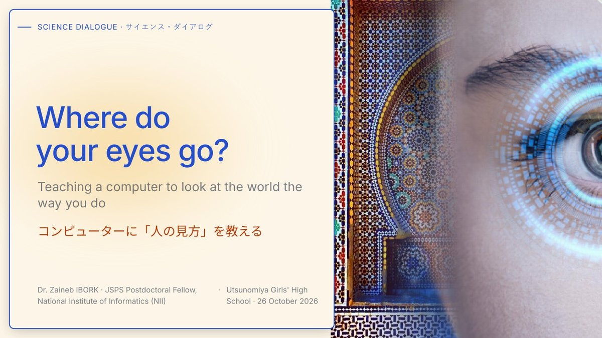

# Where do your eyes go?
### JSPS Science Dialogue · Utsunomiya Girls' High School · 26 October 2026

**Teaching a computer to look at the world the way you do**
コンピューターに「人の見方」を教える

🔗 **Website:** https://zaineb-ibork.github.io/Japan-science-dialogue-2026/



---

## About

This repository hosts the event page and slides for my lecture at **Tochigi Prefectural Utsunomiya Girls' High School** (宇都宮女子高等学校), Japan, on 26 October 2026. I gave it as part of the **[JSPS Science Dialogue Program](https://www.jsps.go.jp/english/e-sdialogue/index.html)**.

The JSPS Science Dialogue Program invites JSPS Fellows to give lectures in English at Japanese high schools, to spark students' interest in research and show science from a global perspective.

The lecture was for about 40 first-year students, aged 15–16. It had three aims:

- to encourage the students to take an interest in research and in learning English
- to show them the path of a researcher
- to introduce them to Morocco 🇲🇦

The lecture was interactive throughout. The students took part in real **subjective tests**: they judged the **quality of 3D meshes**, and they found where their own eyes went first on a 3D model (**visual saliency**).

## Lecture outline

| # | Chapter | Topics |
|---|---------|--------|
| 00 | Hello · こんにちは | Introduction, greetings in Darija, Amazigh, French and Japanese |
| 01 | Morocco and Japan · モロッコと日本 | Geography, population, capitals, shared values, food, clothes, houses |
| 02 | My path to science · なぜ科学者になったの？ | From a curious child in Morocco to a researcher in Japan |
| 03 | My research · 研究内容 | 3D meshes, mesh quality assessment, visual saliency, hands-on activities |
| 04 | How a computer learns to see · 人の目から人工知能へ | Eye-tracking, AI, saliency-guided simplification, how research works |
| 05 | Questions and references · 質疑応答・参考文献 | Q&A and further reading |

## Repository contents

```
├── index.html                                  Event page
├── Ibork_ScienceDialogue_Utsunomiya_2026.pdf   Slides (downloadable)
├── cover.jpg                                   Preview image for link sharing
├── photos/                                     Photos from the day
└── slides/
    ├── full/                                   Slide images for the viewer
    └── thumb/                                  Slide thumbnails
```

## Related publications

- Z. Ibork, A. Sugimoto. *Graph-Structural and Topological Features for Mesh Saliency.* S+SSPR, Bern, 2026.
- Z. Ibork, A. Sugimoto. *SARMA for Textured 3D Meshes Saliency.* ACIVS, Okinawa, 2026.
- Z. Ibork, A. Nouri, O. Lézoray, C. Charrier, R. Touahni. *No Reference 3D Mesh Quality Assessment Learned from Quality Scores on 2D Projections.* IEEE Access, 12, 2024.
- O. Lézoray, Z. Ibork, A. Nouri, C. Charrier. *Saliency Prediction on 3D Meshes Using Residual FeaStConv-Based Graph Neural Networks.* VCIP, 2025.

## Author

**Dr. Zaineb Ibork**
JSPS Postdoctoral Fellow · Computer Vision and Discrete Geometry Group
National Institute of Informatics (NII), Tokyo, Japan
🌐 [zaineb-ibork.github.io](https://zaineb-ibork.github.io)

## Acknowledgements

Thank you to the **Japan Society for the Promotion of Science (JSPS)**, the teachers of Utsunomiya Girls' High School, and the students for their curiosity and energy. ありがとうございました！

## Credits

Unless stated otherwise, the slides, page and photos are © 2026 Zaineb Ibork. Some images in the slides come from Wikimedia Commons (CC BY-SA), NASA/JPL-Caltech, ESA, and published 3D datasets. Each is credited on its slide and on the references slide. Students' faces in the photos are hidden to protect their privacy.
